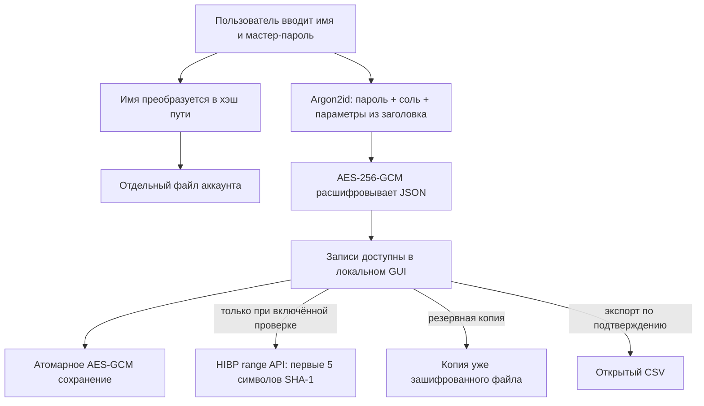

# Aegis: архитектура и модель угроз

## Назначение

Aegis — локальное настольное приложение для хранения учётных данных. Сеть
используется только для добровольной проверки паролей через Pwned Passwords
API; синхронизации хранилищ между устройствами нет.

## Структура хранилища

Каждый новый аккаунт сохраняется в отдельном файле:

```text
<каталог приложения>/vaults/<SHA-256 имени аккаунта>.aegis
```

Имя аккаунта не используется как имя файла. Содержимое — JSON одного аккаунта,
зашифрованный AES-256-GCM. 32-байтовый ключ выводится из мастер-пароля Argon2id
с уникальной 16-байтовой солью. Новый контейнер начинается с заголовка
`AEGISVLT`, версии формата, параметров Argon2id, соли и 12-байтового nonce.
Заголовок передаётся в AES-GCM как associated data, поэтому подмена параметров
KDF обнаруживается при расшифровании. Запись выполняется во временный файл в
том же каталоге с последующей атомарной заменой.

Параметры текущей версии: память 64 MiB, 3 прохода, parallelism 4. Загрузчик
проверяет разумные верхние и нижние границы параметров из файла до запуска KDF.
Старый контейнер вида `[salt][nonce][ciphertext]` читается для миграции.

## Миграция общей базы

Старая версия хранила несколько профилей в `Aegis.db`. При первом успешном
входе профиль переносится в отдельный зашифрованный файл. Источник намеренно
остаётся на месте, чтобы не потерять ещё не перенесённые аккаунты. После входа
все старые профили нужно перенести по очереди, проверить резервные копии и
вручную убрать `Aegis.db` из рабочего каталога. Пока файл остаётся там, он
содержит исходную общую копию. Его удаление из интерфейса пока не автоматизировано.

## Поток данных



## Модель угроз

### Защищаем

- Конфиденциальность записей в файле хранилища при выключенном приложении.
- Целостность зашифрованного содержимого и заголовка KDF с помощью AES-GCM.
- Случайную потерю части файла при сбое во время сохранения.
- Перезапись устаревшими данными при параллельном запуске одного экземпляра.

### Не защищаем

- Разблокированный сеанс от вредоносного ПО, кейлоггера, снимка памяти или
  администратора с полным контролем над Windows-профилем.
- Незашифрованные CSV, сделанные пользователем, и отдельные резервные копии.
- Гарантированное физическое стирание SSD или облачных/синхронизируемых копий.
- Подлинность приложения по локальному хэш-манифесту без внешней подписи.
- Доступность файла, если пользователь забыл мастер-пароль.

Буфер обмена системный; Aegis пытается очистить скопированный пароль по таймеру
и при выходе, только если содержимое буфера не было заменено другим приложением.
Проверки VM/отладчика и задержка входа — дополнительные эвристики, а не граница
безопасности.

## Сеть и приватность

При проверке HIBP приложение вычисляет SHA-1 пароля локально и передаёт только
первые пять шестнадцатеричных символов hash-range-запроса. Полный пароль не
передаётся, но сервис видит IP-адрес и время запроса. Проверка отключена по
умолчанию и включается пользователем в настройках. Профили, перенесённые из
старой версии, также получают выключенную проверку.

## Основные решения для защиты диплома

1. Argon2id повышает цену офлайн-перебора мастер-пароля.
2. AEAD одновременно шифрует данные и обнаруживает изменения ciphertext и
   аутентифицированного заголовка.
3. Раздельные файлы устраняют прежнюю архитектурную зависимость всех аккаунтов
   от одного активного контейнера; смена пароля одного аккаунта не перешифровывает
   остальные.
4. Обратная совместимость реализована чтением старого формата и пошаговым
   переносом профилей без автоматического удаления исходника.

